# Sistema de gestión para talleres por Telegram

**Automatización para pequeños negocios · Piloto con CJ Car Solutions (Trujillo, Perú) · 2026**

Bot de Telegram hecho con **n8n + Google Sheets + IA (Gemini)**. El dueño de un taller de planchado y pintura **hace cotizaciones, controla trabajos, inventario y cobros, y entrega notas de venta en PDF**. Todo lo hace escribiéndole o mandándole notas de voz al bot desde el celular.

📄 **[Ver el caso de estudio completo (PDF)](docs/caso-de-estudio.pdf)**

| Cotización lista en Telegram | PDF que recibe el cliente |
|---|---|
| 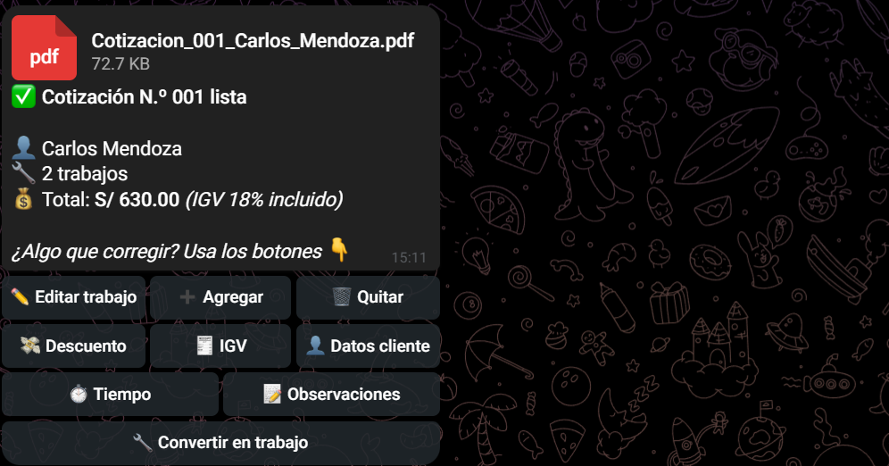 | 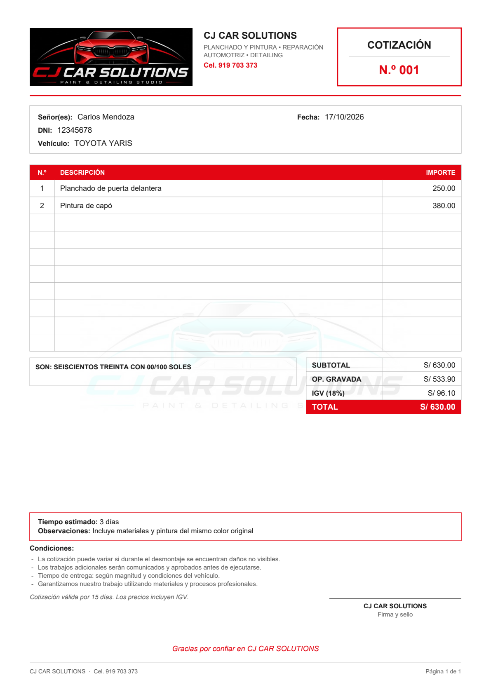 |

---

## El problema

CJ Car Solutions llevaba sus cotizaciones, trabajos, compras de material y cobros en plantillas sueltas y en una hoja de cálculo que había crecido sin orden:

- **Cotizaciones lentas:** se hacían a mano, cada una con un formato distinto y sin un registro ordenado.
- **Inventario poco confiable:** había compras anotadas dos veces, montos escritos como texto, compras cargadas a un "trabajo falso" y productos buscados solo por su nombre.
- **No se sabía cuánto dejaba cada trabajo:** el material usado no se anotaba en cada trabajo.
- **Cobros desordenados:** los adelantos y saldos se llevaban de memoria, y el resumen contaba como ingreso trabajos que todavía no se cobraban.

> El reto: el sistema tenía que poder usarse **con las manos ocupadas, en medio del taller y sin capacitación**. Por eso se usa desde Telegram, con botones y notas de voz.

## La solución

| Parte | Qué hace |
|---|---|
| **Cotizaciones** | Paso a paso con botones o en una sola frase; trabajos, productos o ambos; IGV a elección (sumar, incluido o sin IGV); descuento; PDF con la marca del taller |
| **Trabajos** | Convertir una cotización en trabajo, ver su estado, anotar el material usado y ver **cuánto se ganó en cada trabajo** |
| **Inventario** | Compras, material usado y correcciones después de contar; código de producto automático; aviso cuando queda poco stock y cuánto dinero hay en material |
| **Cobros** | Adelanto y saldo, y lo que falta cobrar |
| **Documentos** | Cotización, nota de venta (por Telegram o correo) y reporte interno en PDF |
| **IA (Gemini)** | Entiende mensajes y notas de voz normales ("compré cinco lijas a cuatro soles") y **siempre pide confirmar** antes de guardar |
| **Roles y licencias** | Dueño y trabajador (el trabajador no ve precios); una clave de activación por taller para poder venderlo a otros talleres |

## Cómo funciona

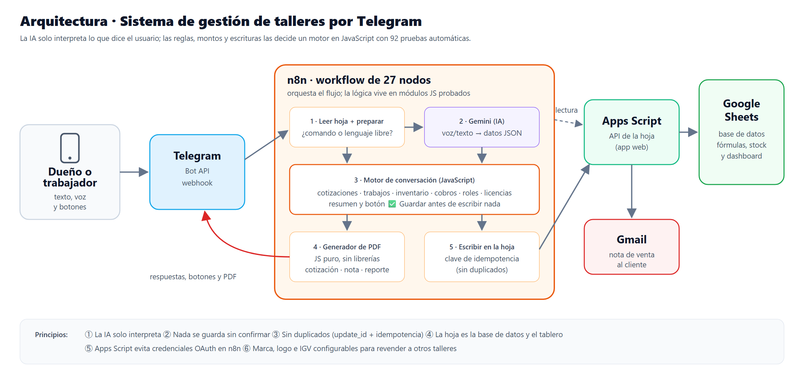

**Decisiones clave:**
- **La IA solo entiende, no decide.** Gemini solo entiende lo que dijo el usuario. Las reglas (montos, stock, permisos) las aplica el programa, que tiene pruebas automáticas. Al principio dejé que la IA guardara directo en la hoja y se creaban registros repetidos.
- **Nada se guarda sin confirmar** (✅ Guardar · ✏️ Corregir · ❌ Cancelar).
- **Sin duplicados:** el bot ignora los mensajes repetidos de Telegram y no guarda dos veces la misma operación.
- **Apps Script conecta la hoja con el bot.** Es un programa dentro de la hoja de Google. Así n8n no necesita permisos directos sobre la cuenta de Google. También envía los correos.
- **El bot arma los PDF por su cuenta**, porque el servicio de n8n que uso no deja instalar programas extra.
- **"Nota de venta", no boleta:** en Perú una boleta válida es electrónica y la emite SUNAT.

## El bot en acción

| Nueva cotización | El bot guía y suma |
|---|---|
| 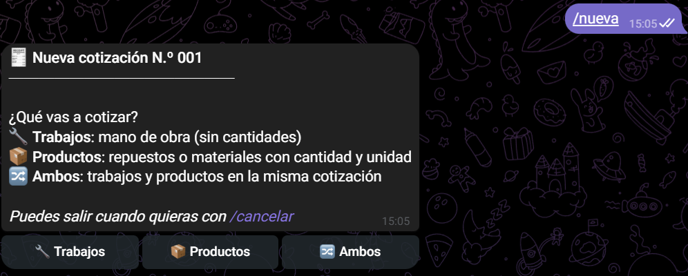 | 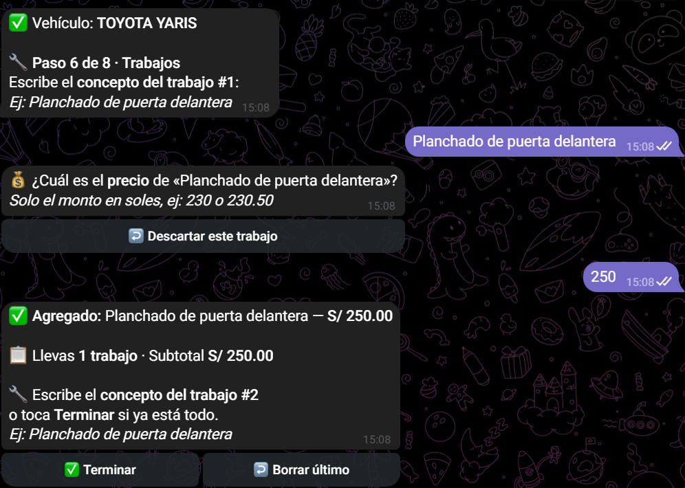 |
| **IGV a elección** | **Resumen antes del PDF** |
| 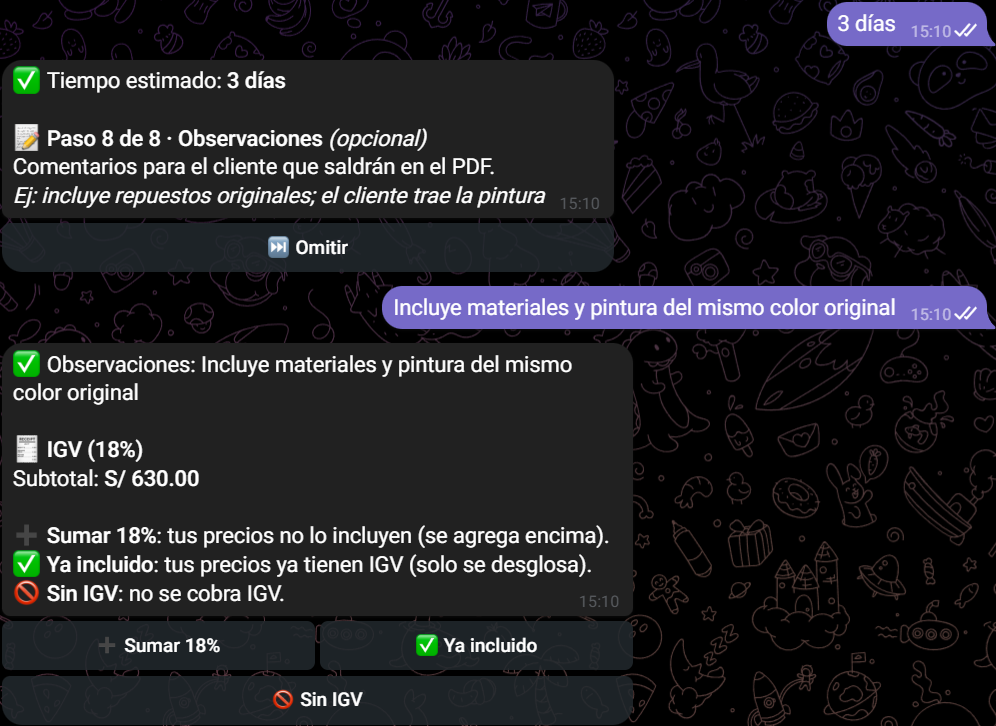 |  |

### IA con control

| Cotización en una frase | Compra dicha con palabras normales (cancelada: no se guarda nada) |
|---|---|
| 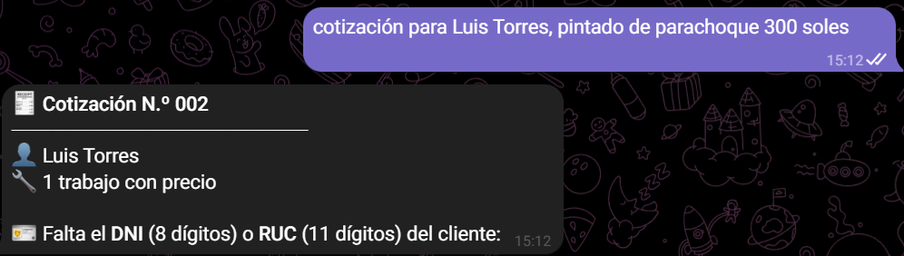 | 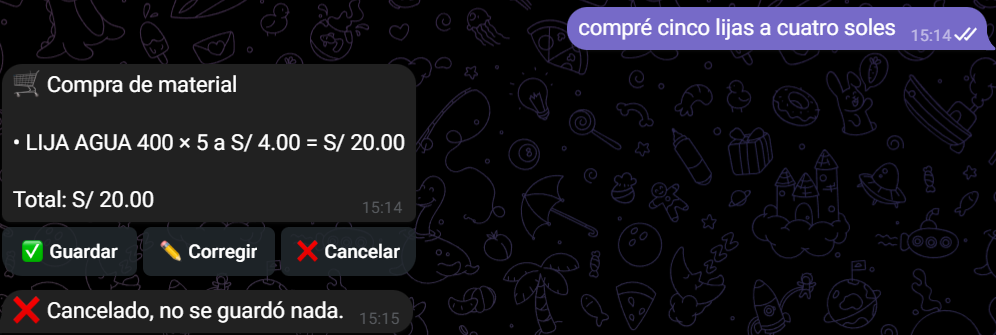 |

### Gestión del taller

| Inventario (comando `/stock`) | Ficha del trabajo y nota de venta |
|---|---|
| 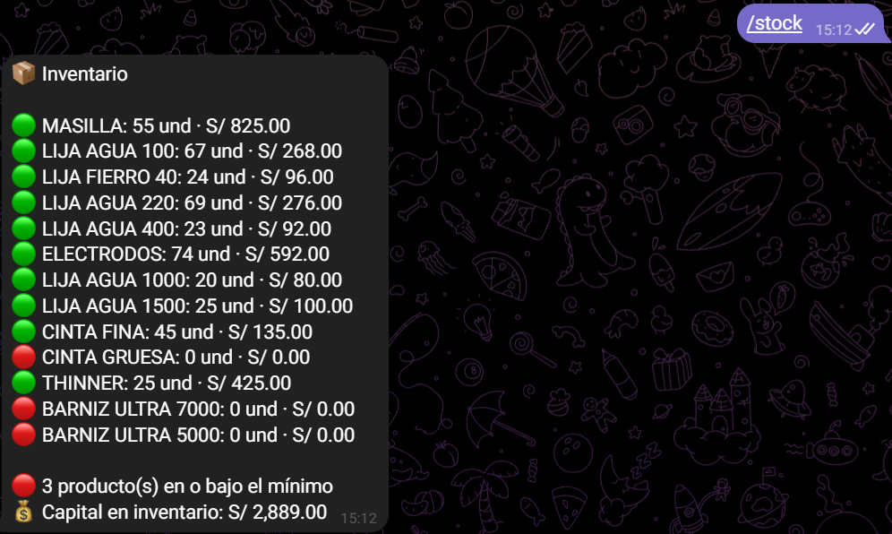 | 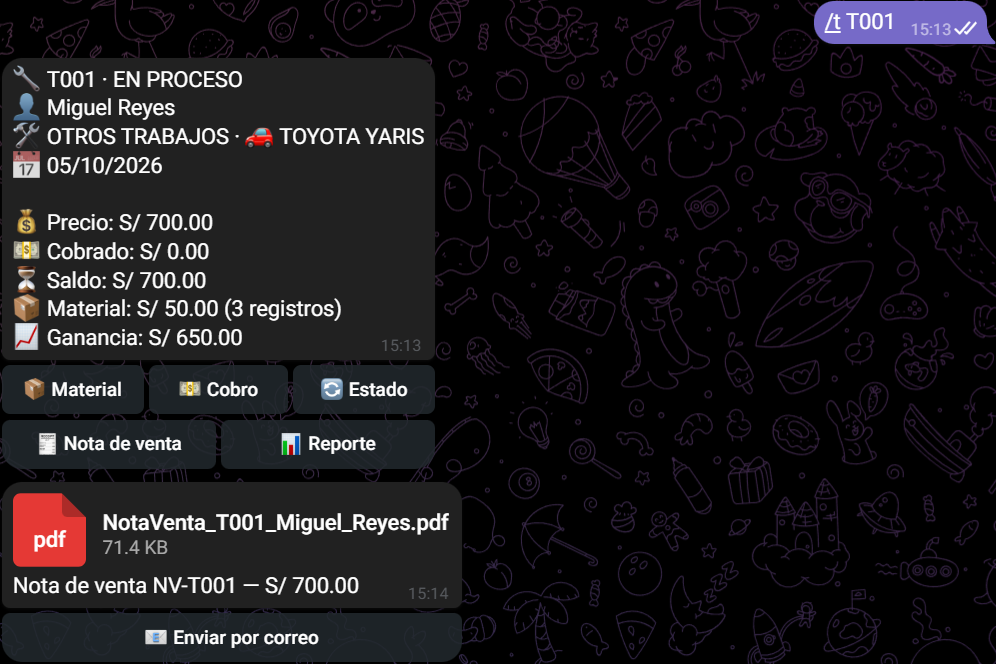 |

### Documentos PDF

| Cotización | Nota de venta | Reporte interno |
|---|---|---|
|  | [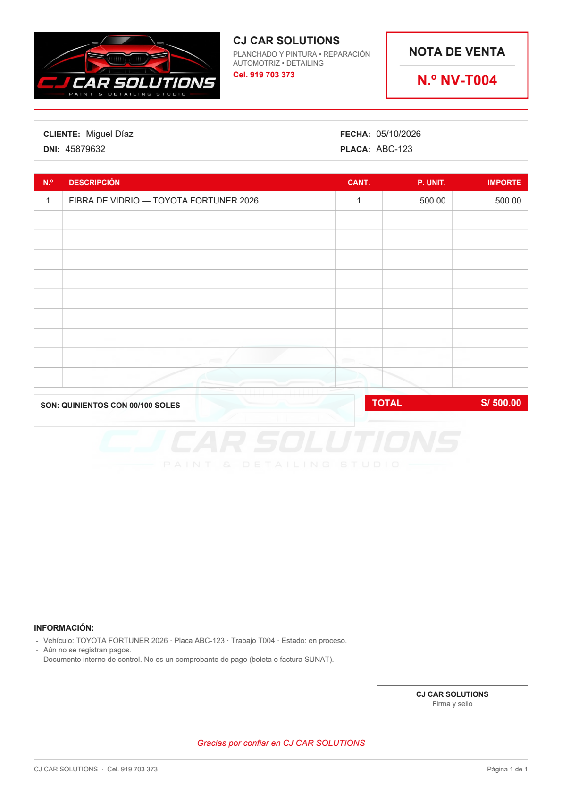](docs/nota-de-venta-ejemplo.pdf) | [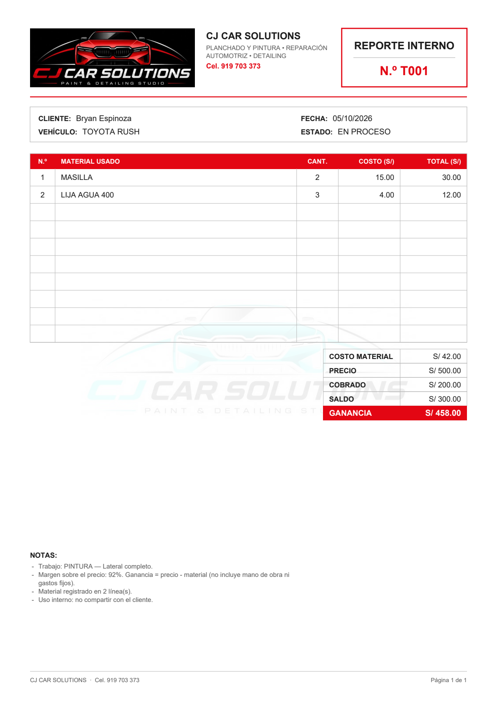](docs/reporte-interno-ejemplo.pdf) |

## El flujo en n8n (27 nodos)

n8n es una herramienta para automatizar flujos: cada caja (nodo) hace un paso, como recibir el mensaje, leer la hoja o enviar el PDF.

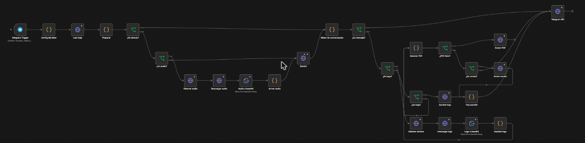

## Tecnologías

- **n8n** (en un servidor de Hostinger): herramienta para automatizar flujos; une Telegram, la IA y la hoja
- **JavaScript:** la lógica del bot (conversación, cálculos, inventario y PDF)
- **92 pruebas automáticas**, todas pasan
- **Google Sheets + Apps Script:** la hoja guarda los datos y muestra el resumen; Apps Script la conecta con el bot
- **Google Gemini:** la IA que entiende mensajes y notas de voz
- **Telegram** (texto, voz, botones y documentos) y **Gmail**

## Estado

- ✅ **Piloto con CJ Car Solutions** (octubre de 2026): cotizaciones, inventario, trabajos, cobros y documentos probados con el bot real.
- ✅ **IA probada en vivo:** 7 de 8 frases reales se entendieron bien a la primera; en la otra, el bot completó los datos y pidió confirmar.
- ⏳ **Pendiente:** probar en vivo el envío por correo, contar físicamente el inventario y hacer un PDF de inventario de varias páginas.
- 🔧 **Siguiente mejora:** atender en orden los mensajes de un mismo chat. Al preparar este caso encontré que, si llegan dos mensajes muy seguidos, el segundo puede leer los datos antes de que se guarde el primero.

## Mi rol

Me encargué del proyecto completo: averigüé qué necesitaba el taller, diseñé cómo funcionaría el sistema y la hoja de cálculo, desarrollé el bot con apoyo de asistentes de IA, preparé las pruebas, lo puse en marcha en n8n y lo probé en vivo con el dueño. También escribí cómo se usa y cómo llevarlo a otros talleres.

---

> 🔒 **Repositorio de muestra:** no se publican el código, las claves, las direcciones internas ni los datos de la hoja. Puedo hacer una demostración en una entrevista.
>
> Las capturas son del bot real conectado a una copia de prueba del flujo, con clientes y datos de prueba.

**Bryan Jeremy Espinoza Herrera** · BJOTA Systems · Trujillo, Perú
